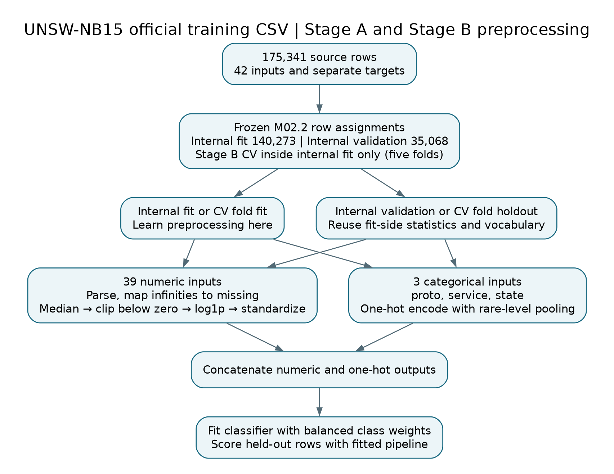

# CET433 — Network Intrusion Detection with Explainable AI for SOC Analysts

A flow-level intrusion detection research project for enterprise security operations centers (SOCs) and managed security service providers (MSSPs). The aim is to help analysts prioritize suspicious flows under high alert volumes, limit false alarms and missed attacks, and eventually explain why an alert was raised. Phase 1 documents the data, leakage safeguards and binary baseline. The team reports completed Stage A and B model comparison runs. Explanation quality, robustness and the analyst prototype still require validation.

| Team member | Student ID |
| --- | --- |
| Mohamed Hesham | 230105474 |
| Radwa Tarek | 230103871 |
| Roaa Tarek | 230103862 |

## Dataset, tasks and research terms

UNSW-NB15 combines normal activities and synthetic attack behavior from a cyber range. The official training CSV has 175,341 rows and 45 columns. The provider documents 82,332 rows in the official test partition, which is reserved for final evaluation. Every model result reported below uses the 35,068-row **internal validation subset of the official training CSV**. No official-test performance is reported.

Binary detection predicts Normal (0) or Attack (1). The prospective ten-class task predicts Normal or one of nine attack families. Its evaluation will use macro-F1, per-class recall and a confusion matrix with class supports. Binary Attack recall aggregates all attack families.

UNSW grants free academic research use in perpetuity and requires citations to five papers, including Moustafa and Slay (2015) and Sarhan et al. Commercial use requires agreement with the authors. The [academic references and terms](deliverables/phase1/dataset-ethics.md) list all five required works and discuss local checksum provenance. [UNSW dataset source](https://research.unsw.edu.au/projects/unsw-nb15-dataset)

## Architecture and leakage controls



The guarded workflow verifies the source and dataset contracts, applies the frozen row assignments, and fits a combined preprocessing and classification pipeline. It excludes `id`, `label` and `attack_cat` from the 42 model inputs. Numeric inputs use median imputation, zero lower clipping, `log1p` and standardization. The categorical inputs (`proto`, `service`, `state`) use dense one-hot encoding with pooling below 0.5% of fit rows. Preprocessing learns only from the relevant fit subset. Controlled models use balanced class weights and seed 42. [Implementation](ids_utils.py) · [Preprocessing details](deliverables/phase1/preprocessing.md)

The official training CSV has 68.06% Attack, no missing values or full-row duplicates, 67,601 extra duplicates after excluding `id` and 74,301 extra occurrences of model-input vectors. There are 229 exact-input groups with conflicting binary labels and 1,772 with conflicting family labels. Extra occurrences count repetitions beyond the first. M02.2 retains the original rows and labels while keeping exact, pre-transform input vectors together.

| Frozen training-only boundary | Rows | Shared exact-feature groups |
| --- | --- | ---: |
| Internal fit and validation | 140,273 fit / 35,068 validation | 0 |
| Five CV folds within internal fit | 28,054–28,055 held out per fold | 0 in each fold |

An ordinary row split can put the same feature vector on both sides. Exact grouping protects those internal boundaries, while near-duplicates, capture context and related flows may still span them. The partition files lack documented usable event timestamps and capture identifiers, so chronological generalization and session independence remain unestablished. [EDA and charts](deliverables/phase1/eda.md) · [Frozen split protocol](docs/m02.2-split-protocol.md) · [Verification record](deliverables/phase1/split-verification.json)

## Binary evaluation

Attack is the positive class. The operating target is **Attack recall ≥95% and FPR <1% at the same threshold**. The policy assigns 5 analyst-equivalent minutes to a false positive and 120 to a false negative. Those weights model error burden without measuring analyst time or savings.

### Stage A · Fixed baseline comparison at 0.5

| Model | Attack precision | Attack recall | F1 | FPR | ROC-AUC |
| --- | ---: | ---: | ---: | ---: | ---: |
| Logistic Regression | 0.962089 | 0.940967 | 0.951411 | 0.079018 | 0.986691 |
| Random Forest | 0.976406 | 0.946665 | 0.961305 | 0.048750 | ≈0.9925 |
| LightGBM | 0.979399 | 0.944151 | 0.961452 | 0.042321 | ≈0.9930 |

Logistic Regression recorded 22,459 TP, 885 FP, 10,315 TN and 1,409 FN. These counts reproduce the threshold metrics, normal recall of 0.920982 and policy cost of 173,505 minutes. The two tree baselines have higher reported F1 and lower FPR than Logistic Regression. The original Stage A metric export and score vectors were unavailable in the checkout. Tree metrics and all AUC values are team-reported, with the tree AUCs provided as approximations. [Baseline and confusion matrix](deliverables/phase1/baseline.md) · [Stage A runbook](docs/m03.1-stage-a.md)

### Stage B · Bounded tree tuning

The team report for `m03-stage-b-001` records 52 completed fits: five candidates per model over the five frozen folds, plus two final refits. Selection within each model family uses mean binary CV F1. The table reports internal validation at 0.5.

| Tuned model | F1 | Attack recall | FPR | Reported ROC-AUC | TP | FP | TN | FN | Policy cost (min) |
| --- | ---: | ---: | ---: | ---: | ---: | ---: | ---: | ---: | ---: |
| Random Forest | 0.968379 | 0.971300 | 0.074018 | 0.992963 | 23,183 | 829 | 10,371 | 685 | 86,345 |
| LightGBM | 0.966011 | 0.955003 | 0.047321 | 0.993947 | 22,794 | 530 | 10,670 | 1,074 | 131,530 |

The team's Downloads README and technical report agree on the counts and metrics. F1, recall, FPR and cost reproduce from the supplied counts. The run manifests, candidate-level exports and score vectors were unavailable locally for independent verification. Tuned Random Forest is the provisional choice under the predefined validation-F1-at-0.5 rule. Both tuned models meet the recall floor at 0.5 and exceed the allowed FPR. The team report records threshold-wide infeasibility for both. Independent verification of that sweep remains pending. [Stage B runbook](docs/m03.4-stage-b.md) · [M03.3 Stage A inference audit](docs/m03.3-validation-audit.md)

## Getting started and reproducing evidence

**Start offline.** Open the [Phase 1 bundle](deliverables/phase1/README.md), [report draft](REPORT_TEMPLATE.md), [speaker outline](PRESENTATION_OUTLINE.md) or [discussion slides](deliverables/phase1/phase1-discussion.pptx). This requires no dataset or model binaries.

**Use an isolated local environment.** The [Python 3.12 reference requirements](requirements.txt) pin the local notebook and dashboard dependencies. The no-fit check itself needs Python 3.11+ with NumPy, pandas and scikit-learn. See the [tested Phase 1 environment and figure replay instructions](deliverables/phase1/README.md).

```sh
python3.12 -m venv .venv
.venv/bin/python -m pip install -r requirements.txt
.venv/bin/python -B -m unittest discover -s tests -v
```

**Verify the frozen evidence.** Obtain the authorized, checksum-matching official training CSV and exact frozen assignment through project custody. Place them at `data/official/UNSW_NB15_training-set.csv` and `artifacts/generated/m02.2-split-assignments.json` respectively. The [dataset manifest](data/dataset_manifest.json) and [split manifest](data/m02.2_split_manifest.json) contain the expected digests. The default command performs read-only verification and reports confusion-derived metrics. It does not open the official test CSV, fit a model or deserialize a trained artifact.

```sh
.venv/bin/python -B deliverables/phase1/generate_evidence.py
```

For controlled M03 replication, follow the versioned [Colab qualification](docs/m02.3-colab-qualification.md), [M03 preflight](docs/m02.4-m03-execution.md), [Stage A](docs/m03.1-stage-a.md) and [Stage B](docs/m03.4-stage-b.md) runbooks. The reported experiment environment used isolated CPython 3.13.18. The versioned input profiles are tracked and the project-held exact lock and snapshot are separately required. The general notebook dataset preflight can inspect both official partitions. Use the Phase 1 verifier for a training-only demo.

## Repository map

| File or directory | Role |
| --- | --- |
| [`colab_preflight.py`](colab_preflight.py), [`colab_acceptance.py`](colab_acceptance.py), [`grouped_splits.py`](grouped_splits.py), [`data/`](data/) | Dataset contracts, split construction and acceptance, frozen metadata |
| [`ids_utils.py`](ids_utils.py), [`m03_runner.py`](m03_runner.py), [`stage_a.py`](stage_a.py), [`stage_b.py`](stage_b.py) | Preprocessing and controlled model workflows |
| [`m03_validation_audit.py`](m03_validation_audit.py) | Stage A inference-only audit of authenticated artifacts and validation scores |
| [`CET433_Project2_IDS_M01R.ipynb`](CET433_Project2_IDS_M01R.ipynb), [`docs/`](docs/) | Guarded notebook and versioned runbooks. The required starter notebook is retained for history. |
| [`deliverables/phase1/`](deliverables/phase1/), [`tests/`](tests/), [`environment/`](environment/) | Phase 1 evidence, automated tests and dependency profiles |
| [`app/soc_dashboard.py`](app/soc_dashboard.py) | Prototype dashboard source awaiting integrated validation |

## Phase milestones

Phase 1 covers the SOC market case, dataset and preprocessing, and the binary baseline. The rubric mapping and evidence status are in the [submission manifest](deliverables/phase1/submission-manifest.md).

| Phase 2 work | Acceptance evidence |
| --- | --- |
| Model comparison and operating gate | Authenticate run records and verify Stage A/B metrics, provenance and threshold feasibility against frozen validation without model refitting. Record improvements and failure cases. |
| Ten-class evaluation | Use frozen fit folds and evaluate on internal validation with fixed labels, macro-F1, class recall, a confusion matrix and rare-family support. |
| Global and local explanations | Validate explanation output, positive-class attribution and feature mapping. Include a global summary and traceable false-positive and false-negative cases. Assess usefulness for analyst triage. |
| Robustness and distribution shift | Predefine a defensive drift evaluation, choose approved benchmark data, and report changes in errors and operating performance. Substantiate chronology separately if timestamped data becomes available. |
| SOC prototype and latency | Validate input schemas and trusted model loading. Demonstrate alert ranking and explanation display on approved examples. Record hardware, batch size and latency distribution. |
| Final report and defense | Freeze model selection and the evaluation policy before authorized holdout scoring. Report aggregate and exact-feature-unseen results, assumptions, citations and evidenced team contributions. |

The benchmark's traffic mix and class prevalence differ from what a SOC may encounter. Explanations are proposed aids for human review, and operational impact has not been measured. Use publicly permitted data and approved test inputs, protect raw flows and credentials, and deserialize models only from authenticated project custody. No production deployment readiness is claimed.
