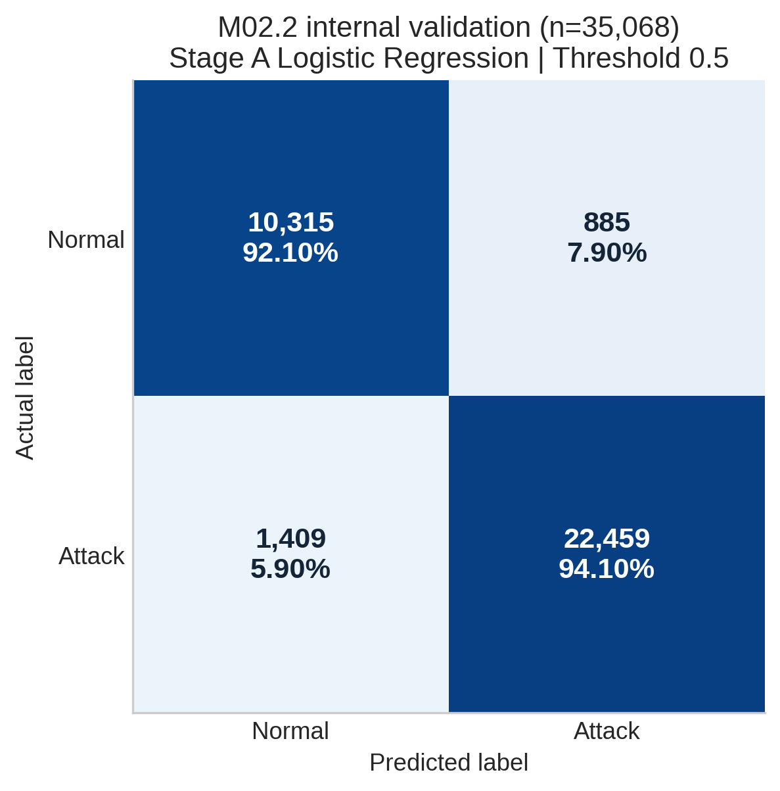

# Stage A binary baseline

**Partition:** M02.2 internal validation within the official UNSW-NB15 training CSV, 35,068 rows. **Model:** Logistic Regression fitted previously on 140,273 M02.2 internal fit rows. A score ≥ 0.5 predicts Attack. The supplied Stage A aggregate is transcribed in [baseline.json](baseline.json). The run export and score vector were unavailable in this checkout.

| Actual \ Predicted | Normal | Attack | Support |
| --- | ---: | ---: | ---: |
| Normal | 10,315 TN | 885 FP | 11,200 |
| Attack | 1,409 FN | 22,459 TP | 23,868 |

| M02.2 internal validation metric | Calculation | Value |
| --- | --- | ---: |
| Attack precision | 22,459 / 23,344 | 0.962089 |
| Attack recall | 22,459 / 23,868 | 0.940967 |
| Attack F1 | 44,918 / 47,212 | 0.951411 |
| Normal recall (specificity) | 10,315 / 11,200 | 0.920982 |
| False-positive rate | 885 / 11,200 | 0.079018 |
| Accuracy | 32,774 / 35,068 | 0.934584 |
| ROC-AUC | Reported from score rankings in the supplied aggregate | 0.986691 |

The confusion-derived metrics reproduce to six decimal places. ROC-AUC requires validation scores across thresholds and cannot be reconstructed from one confusion matrix. The validation supports match the frozen split manifest.

Under the predefined policy, the baseline costs **5 × 885 + 120 × 1,409 = 173,505 analyst-equivalent minutes**, or 2,891.75 analyst-equivalent hours on M02.2 internal validation. The contributions are 4,425 and 169,080 minutes. These weights represent assumptions about triage and missed-attack impact. They do not measure effort, savings or monetary loss.

At 0.5, attack recall is 94.10% and FPR is 7.90%. Both miss the frozen targets of recall ≥95% and FPR <1%. Joint attainment has not been established for the project. A high AUC does not establish feasibility at any particular operating point. Accuracy hides the differing harms of missed attacks and false alarms and changes with prevalence. An attack-only rule would already reach 68.06% accuracy with 100% FPR on this validation set.

This is a single binary benchmark result under grouped, within-dataset validation. It supplies no measured attack-family recall, external holdout performance, chronological generalization, calibrated probabilities or deployment evidence. Logistic Regression estimates a linear log-odds relationship over the transformed inputs, which may miss interactions. Conflicting exact vectors and low support for some families also limit interpretation.
