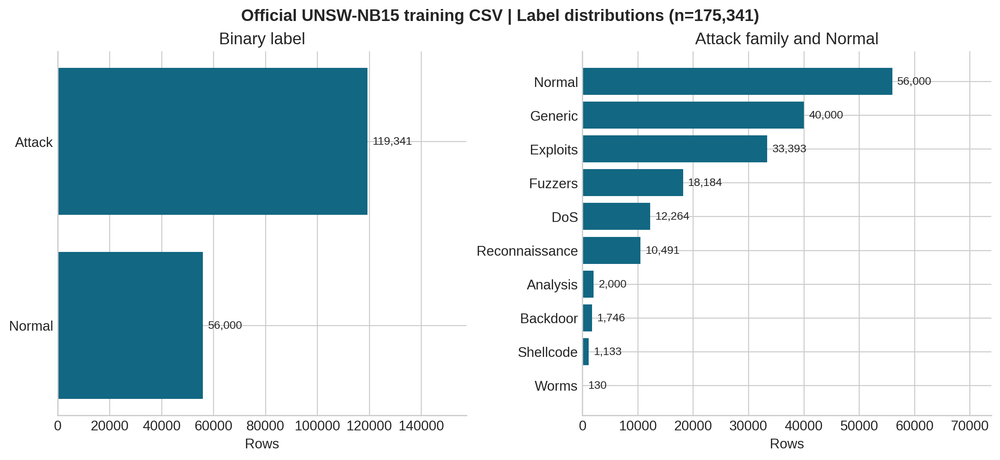
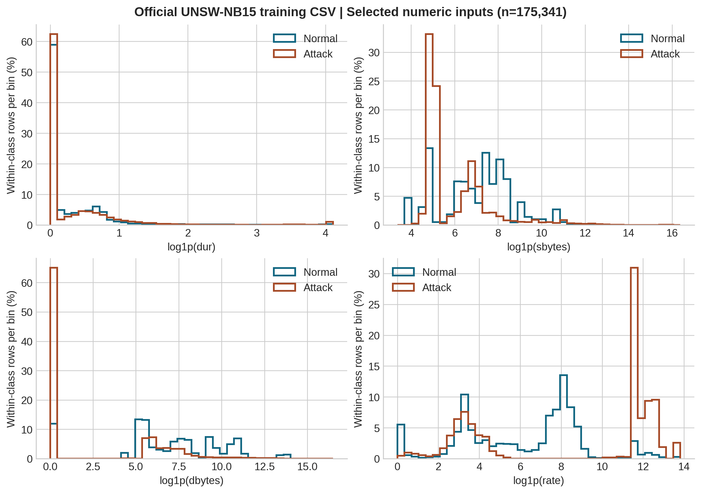
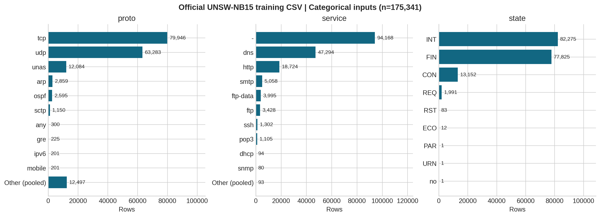

# UNSW-NB15 training-partition EDA

One observation is one CSV row. All statistics below use the raw published partition schema before learned transforms. Internal fit and validation are disjoint subsets of the official training CSV. The [dataset contract](../../data/dataset_manifest.json) documents the expected local checksum and schema. The [split audit](split-verification.json) records the verified checksum and frozen supports.

## Shape, completeness and repeated observations

| Measure | Official UNSW-NB15 training CSV | M02.2 internal fit | M02.2 internal validation |
| --- | ---: | ---: | ---: |
| Observations | 175,341 | 140,273 | 35,068 |
| Original columns | 45 | 45 | 45 |
| Integer columns | 30 | 30 | 30 |
| Floating-point columns | 11 | 11 | 11 |
| Text columns | 4 | 4 | 4 |
| Numeric model inputs | 39 | 39 | 39 |
| Categorical model inputs | 3 | 3 | 3 |
| Missing cells | 0 | 0 | 0 |
| Blank/whitespace text cells | 0 | 0 | 0 |
| Infinite numeric cells | 0 | 0 | 0 |
| Extra duplicate rows (all columns) | 0 | 0 | 0 |
| Extra duplicate rows (excluding id) | 67,601 | 54,086 | 13,515 |
| Distinct model feature groups | 101,040 | 80,833 | 20,207 |
| Extra duplicate feature vectors | 74,301 | 59,440 | 14,861 |
| Repeated feature groups | 9,748 | 7,800 | 1,948 |
| Rows in repeated feature groups | 84,049 | 67,240 | 16,809 |
| Largest feature group (rows) | 415 | 415 | 166 |
| Groups with conflicting binary label | 229 | 183 | 46 |
| Rows in groups with conflicting binary label | 940 | 753 | 187 |
| Groups with conflicting family label | 1,772 | 1,416 | 356 |
| Rows in groups with conflicting family label | 30,528 | 24,403 | 6,125 |

## Class distributions

Binary codes are 0 = Normal and 1 = Attack. Family percentages use all rows in each named partition, including Normal.

| Target | Class | Official UNSW-NB15 training CSV (count, %) | M02.2 internal fit (count, %) | M02.2 internal validation (count, %) |
| --- | --- | ---: | ---: | ---: |
| label | Attack (1) | 119,341 (68.0622%) | 95,473 (68.0623%) | 23,868 (68.0621%) |
| label | Normal (0) | 56,000 (31.9378%) | 44,800 (31.9377%) | 11,200 (31.9379%) |
| attack_cat | Normal | 56,000 (31.9378%) | 44,800 (31.9377%) | 11,200 (31.9379%) |
| attack_cat | Generic | 40,000 (22.8127%) | 32,000 (22.8127%) | 8,000 (22.8128%) |
| attack_cat | Exploits | 33,393 (19.0446%) | 26,715 (19.0450%) | 6,678 (19.0430%) |
| attack_cat | Fuzzers | 18,184 (10.3706%) | 14,547 (10.3705%) | 3,637 (10.3713%) |
| attack_cat | DoS | 12,264 (6.9944%) | 9,811 (6.9942%) | 2,453 (6.9950%) |
| attack_cat | Reconnaissance | 10,491 (5.9832%) | 8,393 (5.9833%) | 2,098 (5.9827%) |
| attack_cat | Analysis | 2,000 (1.1406%) | 1,600 (1.1406%) | 400 (1.1406%) |
| attack_cat | Backdoor | 1,746 (0.9958%) | 1,397 (0.9959%) | 349 (0.9952%) |
| attack_cat | Shellcode | 1,133 (0.6462%) | 906 (0.6459%) | 227 (0.6473%) |
| attack_cat | Worms | 130 (0.0741%) | 104 (0.0741%) | 26 (0.0741%) |

Attacks are the majority at 68.06% in the official training CSV and approximately the same share in the internal subsets. Generic and Exploits dominate the attack families. Worms has 130 observations in the official training CSV and only 26 in M02.2 internal validation. Live SOC attack prevalence may be substantially different. Evaluate per-class metrics and report support alongside average performance.

## Reading the quality checks

- The model uses 39 numeric and three categorical inputs (`proto`, `service`, `state`). The original schema also contains numeric `id` and `label` columns and text `attack_cat`.
- No parsed missing values, blank or whitespace-only text values, or numeric infinities were observed in any shown partition. The [missingness table](missing.tsv) gives counts and percentages for each of the 45 columns and uses the named partition's row count as denominator. A literal `-` is a recorded categorical level.
- An extra duplicate is any occurrence after the first for the specified key. All-column duplicates include `id`. Excluding `id` retains both labels. Exact model-input groups use only the 42 features under the M02.2 canonical grouping policy. In the official training CSV, 74,301 rows (42.38%) are additional feature-vector occurrences and 84,049 rows (47.93%) lie in repeated groups when first occurrences are included. The controlled pipeline retains these observations.
- A conflicting group has identical model inputs and multiple observed values for the indicated target. Binary conflicts are included among family conflicts because Normal is the only family with binary label 0. In the official training CSV, 229 groups (940 rows) have conflicting binary labels and 1,772 groups (30,528 rows) have conflicting family labels. These cases demonstrate ambiguity given the recorded features and labels. The cause is undetermined.

## Numeric and categorical feature summaries

| Official training CSV feature | Median | Mean | First quartile | Third quartile |
| --- | ---: | ---: | ---: | ---: |
| dur | 0.001582 | 1.359389 | 0.000008 | 0.668069 |
| sbytes | 430 | 8,844.84 | 114 | 1,418 |
| dbytes | 164 | 14,928.92 | 0 | 1,102 |
| rate | 3,225.81 | 95,406.19 | 32.79 | 125,000.00 |

The means exceed the medians for these selected raw features. The [numeric summary table](numeric-summary.tsv) contains count, mean, sample standard deviation, minimum, quartiles and maximum for all 39 numeric inputs in each named partition.

The histogram display uses log1p with shared bin boundaries per feature and percentages normalized separately within each binary class. The descriptive summary uses raw units.

TCP and UDP collectively account for 81.69% of official training rows. The literal service level `-` accounts for 53.71%, and state `INT` accounts for 46.92%. The figure displays the ten most frequent levels for fields with more than ten levels and pools the rest in the display. The [complete distribution table](distributions.tsv) retains every level for each partition.

Use the [split and preprocessing evidence](preprocessing.md) and [dataset terms and citations](dataset-ethics.md) with this report.
