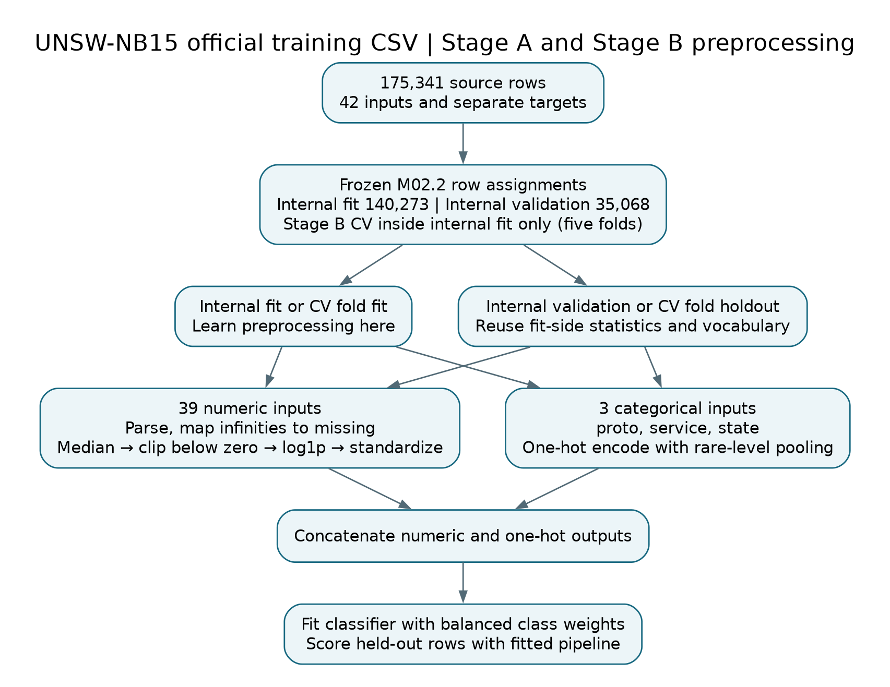

# Preprocessing and leakage control

## Actual controlled pipeline

- Input column order comes from the dataset contract. Exclude row identifier `id` and both targets `label` and `attack_cat`. Stage A uses `label` for fitting, with `attack_cat` available in the dataset for split support. It retains repeated and conflicting observations. The legacy `clean()` helper deduplicates after dropping the ID, but Stage A's `partitions()` calls `prepare_features()` directly and does not invoke that helper.
- The 39 numeric fields must be numeric or parseable as numbers. Incompatible values are rejected and ±infinity becomes missing. The numeric branch learns a median per column on its fitting subset, imputes, clips values below zero to zero, applies `log1p` to every numeric field, then uses `StandardScaler` to center and standardize the transformed numeric columns using fit-side means and scales. There is no upper clipping.
- The categorical branch accepts text or missing values in `proto`, `service` and `state`. There is no separate categorical imputer. Dense one-hot encoding groups levels below 0.5% of fitting rows for each field. An unseen level maps to that field's infrequent bucket if present, or an all-zero block otherwise. One-hot columns bypass the scaler.
- Stage A uses `Pipeline(pre, clf)` with a `ColumnTransformer`. Logistic Regression uses `lbfgs`, C = 1.0, a 1,000-iteration cap, `class_weight="balanced"` and seed 42. The other controlled classifiers also use balanced class weights. Class weights compensate for unequal supports using inverse frequencies on each fit (for Logistic Regression, n / (number of classes × class count)). They change the learning objective while preserving row counts.
- Stage A fits on internal fit. Stage B clones the preprocessing and classifier together per candidate and fit fold, then refits the selected pipeline on all internal fit rows. Held-out rows are transformed with the corresponding fit-side state. Fitting preprocessing before splitting would expose validation or fold holdout medians, means, variances, category vocabularies and frequencies to model development. The per-row parsing and deterministic transform rules do not learn population statistics. [Shared preprocessing](../../ids_utils.py) · [Stage A](../../stage_a.py) · [Stage B](../../stage_b.py)

## Frozen M02.2 membership

The verified official UNSW-NB15 training CSV is the only source of these partitions. The row order and the original 175,341 assignment codes are checksum-bound. Code V denotes validation. Codes 0–4 designate held-out CV folds inside internal fit. Seed 42 was used for the original stratified group procedure. The Phase 1 audit rechecked hashes, groups and membership without regenerating assignments.

| Official training CSV boundary | Fit rows | Held-out rows | Shared exact-feature groups |
| --- | ---: | ---: | ---: |
| M02.2 internal fit vs internal validation | 140,273 | 35,068 | 0 |
| M02.2 internal CV fold 0 | 112,218 | 28,055 | 0 |
| M02.2 internal CV fold 1 | 112,219 | 28,054 | 0 |
| M02.2 internal CV fold 2 | 112,218 | 28,055 | 0 |
| M02.2 internal CV fold 3 | 112,218 | 28,055 | 0 |
| M02.2 internal CV fold 4 | 112,219 | 28,054 | 0 |

The observed overlap problem is visible in the official training CSV itself. There are 9,748 repeated exact groups spanning 84,049 rows. An ordinary row-wise random split, even if stratified by label, lets identical 42-input vectors land on both sides. For example, with independent 80/20 assignment, a two-row group has a 32% chance of crossing. Repeating a feature vector across a boundary can inflate validation performance and hide ambiguity when labels conflict. No comparison split was generated for this phase.

The M02.2 key uses ordered parsed model inputs before learned transforms. It normalizes numeric signed zero, preserves text exactly, and hashes canonical tuples. It keeps original labels and row weights. There are 80,833 fit groups and 20,207 validation groups. Exact grouping cannot isolate related flows, sessions, near-duplicates, shared capture context or collisions after transformations such as rare-category pooling. The partition columns lack documented event timestamps and capture IDs, so temporal generalization remains untested. [Frozen manifest](../../data/m02.2_split_manifest.json) · [Protocol](../../docs/m02.2-split-protocol.md) · [Computed split verification](split-verification.json)
